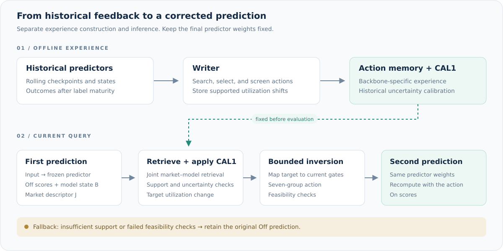

<p align="center">
  
</p>

<h3 align="center">面向金融排序的模型感知动作记忆</h3>

<p align="center">
  历史经验 · 模型感知检索 · 选择性反馈
</p>

<p align="center">
  <a href="README.md">English</a> &nbsp; / &nbsp;
  <a href="#快速开始">快速开始</a> &nbsp; / &nbsp;
  <a href="code/README.md">训练指南</a> &nbsp; / &nbsp;
  <a href="docs/DATA.md">数据说明</a> &nbsp; / &nbsp;
  <a href="CITATION.cff">引用信息</a>
</p>

---

## 项目概览

**MEF-Rank** 是面向金融排序的模型感知动作记忆框架。历史经验能否适用于当前预测，既取决于市场环境，也取决于预测器当前如何利用金融信号。MEF-Rank 将这两方面结合起来，把标签已成熟的历史预测反馈转化为可复用的信号利用调整。

离线阶段，**Writer** 搜索并筛选历史动作，将其对应的信号利用变化与市场、模型状态共同存入记忆。推理阶段，联合检索选择相容经验，校准机制控制反馈强度，有界反解将目标变化映射到当前预测器的门控坐标，再由固定权重的模型重新计算表征，使历史反馈能够明确作用于当前排序决策。

**面向不同预测主干与市场的可迁移设计。** MEF-Rank 通过统一的七组信号接口，将反馈机制与主干内部的表征方式分离。各主干适配器将这一接口连接到序列、变量或 patch 表征，使 Writer、检索、校准和动作反解能够沿用共同流程。仓库已包含十个主干的适配实现和五个市场的配置；扩展到新场景时，可围绕信号接口和数据配置完成接入，再为对应主干、市场和 seed 构建历史经验、记忆与校准。

| 设计优势 | 带来的能力 |
| :--- | :--- |
| **跨架构、跨市场的框架可迁移性** | 通过统一动作接口与主干适配器复用反馈流程，同时为各模型和市场分别构建历史经验、记忆与校准，保留场景自身的上下文。 |
| **同时理解市场与模型的联合检索** | 同时依据市场条件与预测器的决策状态匹配历史经验，使经验相关性与实际接收反馈的模型相对应。 |
| **相容模型状态之间的动作迁移** | 记忆保存七组金融信号的目标利用变化，再通过当前门控的有界反解实现动作，考虑门控饱和状态带来的差异，也便于从信号组层面检查调整内容。 |
| **经过筛选的历史经验** | Writer 将方向搜索、剂量选择和留出筛选分开，并保留经验的支持度、质量和不确定性信息，为后续选择提供依据。 |
| **固定权重下的反馈增强** | 被接受的动作通过一次额外前向传播作用于模型，无需在测试时更新参数。Off/On 使用同一份最终预测器权重，便于隔离历史反馈带来的影响。 |
| **选择性执行与明确回退** | 根据支持度、不确定性和可行性决定是否执行动作。条件不足时保留原始 Off 预测，并记录回退原因，便于分析经验何时适用。 |

## 方法流程

<p align="center">
  
</p>

**Off** 是第一次预测；**On** 根据历史经验调整七组信号的利用方式，再通过同一权重的模型完成第二次预测。两种设置均使用原重排 **1 号数据**。详细流程和工程适配见[实现说明](code/IMPLEMENTATION.md)。

## 快速开始

**运行环境：** Linux · Python 3.10 / 3.11（含 `venv`）· Git。首次安装需要网络连接；训练支持兼容的 CUDA 环境或 CPU。

取得获授权的加密数据及对应密钥，将数据放入 `data_encrypted/<数据集>/`，密钥保存在仓库外。目录和数据获取方式见[数据说明](docs/DATA.md)。

在仓库根目录启动配对训练与评估：

```bash
bash code/run.sh --dataset gem --model STR --key-file /secure/keys/gem.key --device cuda
```

请替换示例密钥路径。启动脚本会准备本地环境、安装固定版本的上游源码，并依次执行最终预测器训练、历史训练、Writer、Memory、校准和配对评估。CPU 可使用 `--device cpu`。

<details>
<summary><b>使用已有的 Python / CUDA 环境</b></summary>

先在已有环境中安装 `code/requirements.txt` 所列依赖，再执行：

```bash
MEF_PYTHON=/path/to/python bash code/run.sh --dataset nasdaq100 --model iTransformer --key-file /secure/keys/nasdaq100.key --device cuda
```

手动安装、独立模型入口、配置参数和断点恢复方式见[训练指南](code/README.md)。

</details>

## 模型与市场

**十个主干：** STR · iTransformer · TimeMixer · ModernTCN · SOFTS · TimeXer · TimeBridge · TimeFilter · SRSNet · ChannelTokenFormer。

| 数据集 | 市场 | 命令参数 |
| :--- | :--- | :--- |
| 创业板 | 中国股票 | `--dataset gem` |
| A 股主板 | 中国股票 | `--dataset main` |
| NASDAQ-100 | 美国股票 | `--dataset nasdaq100` |
| S&P 500 | 美国股票 | `--dataset sp500` |
| Crypto-15 | 加密资产 | `--dataset crypto` |

通过 `--model` 选择主干，例如 `--model TimeMixer`。配对对比使用默认的 **`--mode both`**；也支持 `off` 和 `on`。各模型在 `code/models/` 中设有独立入口。分别执行独立入口会创建不同 run，除非显式恢复同一个运行目录。

## 目录结构

<details>
<summary><b>展开查看代码与文档结构</b></summary>

```text
.
├── README.md                  英文项目首页
├── README.zh-CN.md             中文项目首页
├── CITATION.cff               引用元信息
├── CONTRIBUTING.md            代码改进指南
├── THIRD_PARTY_NOTICES.md      第三方来源说明
├── docs/
│   ├── assets/                项目横幅与流程图
│   └── DATA.md                数据获取与目录说明
├── code/
│   ├── train.py               统一训练入口
│   ├── run.sh                 环境准备与启动
│   ├── requirements.txt       Python 依赖
│   ├── config/                训练及主干配置
│   ├── models/                十个主干的 Off/On 入口
│   ├── handoff/               数据读取与流水线调度
│   ├── src/                   适配器、训练和评估
│   ├── vendor/                共享 MEF 组件
│   ├── third_party/           上游版本与文件哈希
│   └── tests/                 既有专项测试
└── data_encrypted/            获授权的本地数据，不进入 Git
```

上游源码通过 `code/setup_sources.py` 安装，不进入 Git；本地环境、加密数据、密钥和运行输出同样排除。

</details>

## 运行产物

结果默认保存在 `code/outputs/<数据集>/<模型>/seed_<seed>/<run>/`。

| 产物 | 内容 |
| :--- | :--- |
| `run_manifest.json` | 配置、代码与数据身份、设备信息 |
| `main/model.pt` | 共享最终预测器权重与训练期 scaler |
| `history/` | 历史权重、Writer 记录与拒绝原因 |
| `memory.json` / `calibration.json` | 经验记忆与校准结果 |
| `predictions.parquet` | 预测与标签；`both/on` 模式保存配对输出 |
| `metrics.json` / `daily_metrics.csv` | 排序指标、配对差异与回退记录 |

完整产物说明和各模式的差异见[训练指南](code/README.md#4-输出与改进位置)。

## 文档导航

| 文档 | 用途 |
| :--- | :--- |
| [训练与配置](code/README.md) | 安装、命令参数与断点恢复 |
| [数据说明](docs/DATA.md) | 加密数据包、数据视图与访问方式 |
| [实现说明](code/IMPLEMENTATION.md) | 组件、来源和工程细节 |
| [改进指南](CONTRIBUTING.md) | 代码改进的位置与约定 |
| [第三方来源](THIRD_PARTY_NOTICES.md) | 上游源码出处 |

---

<p align="center">
  <b>代码与数据咨询</b><br>
  <a href="mailto:yifany@bupt.edu.cn">yifany@bupt.edu.cn</a>
</p>
